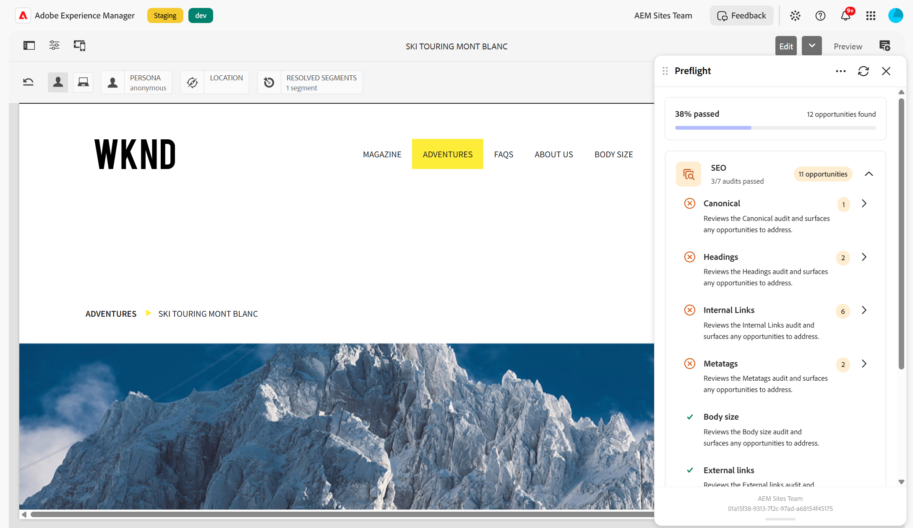

# 預檢 — SEO稽核

預檢結果儀表板中的{align="center"}

Preflight中的&#x200B;**SEO**&#x200B;類別會將稽核分組，以評估針對搜尋引擎最佳化頁面的效果。 當您執行「印前檢查」稽核時，這些稽核會評估頁面的中繼資料、標題結構、連結和內容，以及您可以在發佈之前檢閱和解決的表面商機。

在結果儀表板中，展開&#x200B;**SEO**&#x200B;類別以檢視每個稽核、是否通過以及找到的機會數。 選取稽核以開啟其詳細資訊頁面並處理商機。 若要瞭解如何解譯結果並解決機會，請參閱[預檢中的稽核結果](../audit-results.md)。

SEO類別包含下列稽核：

* [中繼資料](./seo/metatags.md) — 檢閱頁面標題、中繼說明和H1標題。
* [標題](./seo/headings.md) — 檢閱頁面的標題結構和順序。
* [內部連結](./seo/internal-links.md) — 檢閱頁面上指向您自己網站的連結。
* [外部連結](./seo/external-links.md) — 檢閱頁面上指向其他網站的連結。
* [規範](./seo/canonical.md) — 檢閱頁面的規範連結。
* [內文大小](./seo/body-size.md) — 檢閱頁面上的內文內容量。
* [Lorem ipsum](./seo/lorem-ipsum.md) — 偵測內容中剩餘的預留位置文字。
